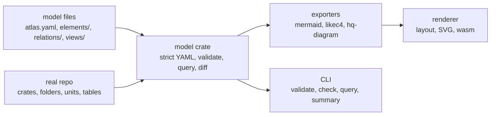

# Architecture

atlas turns a text model of a system into checked facts and diagrams. Three parts, one workspace once the code moves
here ([extraction plan](extraction.md)); words are defined in [boundaries.md](boundaries.md).

| Part | Today (in HQ) | Job |
| --- | --- | --- |
| Model and CLI | `crates/atlas` | read the files strictly, validate, check source tags against the repo (drift), query, summarise, diff, export |
| Diagram model and renderer | `crates/hq-diagram` | layout and draw a view; the schema of a diagram file |
| Browser build | `crates/hq-diagram-wasm` | the renderer as WebAssembly for a web page |

Rules that hold the parts apart:

- The model never draws; the renderer never reads the repo. The exporters are the only bridge.
- Output of the model, the exporters and the renderer is pinned by golden files; the format (`atlas/0`) is in
  [format.md](format.md).
- A check fails the gate when the model and the code drift apart; the model is data in git, reviewed like code.
